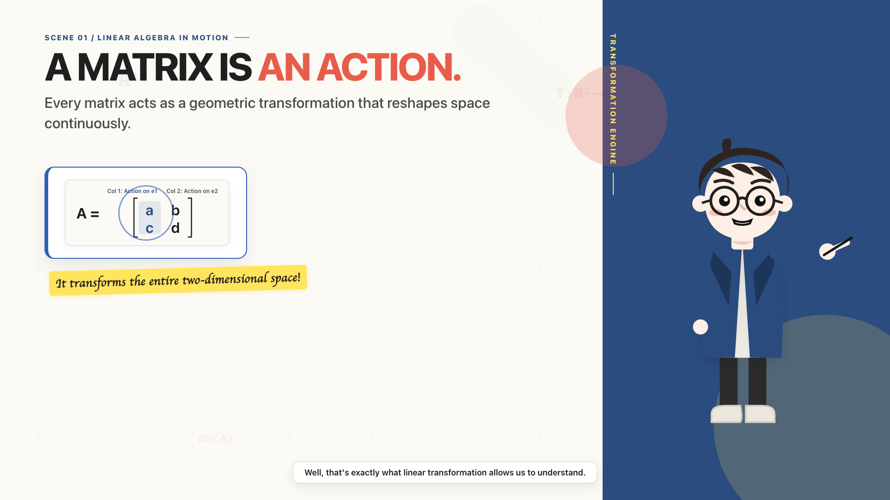
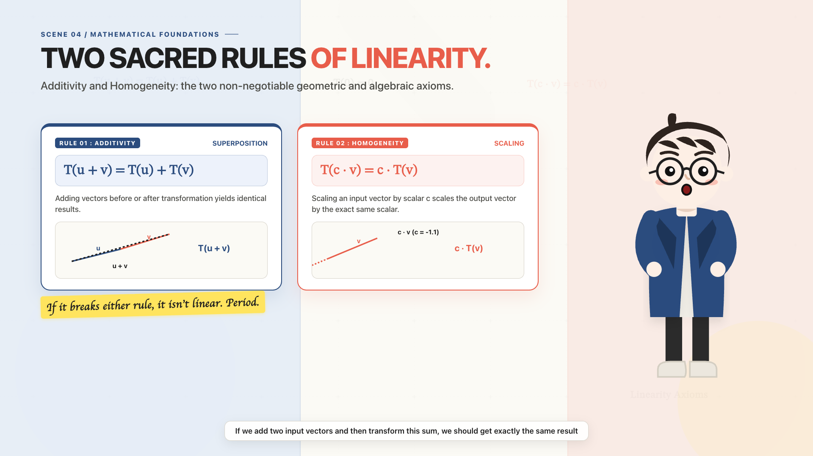
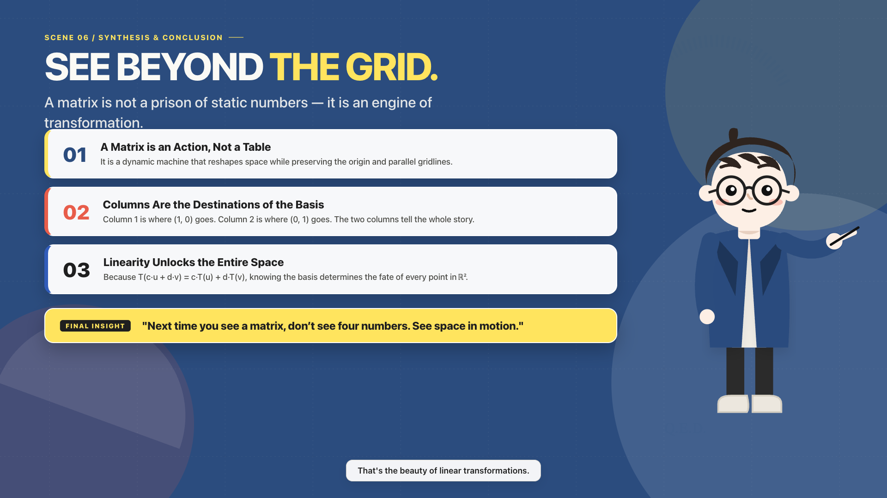

# THE MATRIX EFFECT
### *How Matrices Transform Space*

> **An animated mathematical explainer exploring how matrices reshape two-dimensional space through basis vectors, shear transformations, and the two fundamental axioms of linearity.**



---

## 🎬 Watch the Film

The complete 5-minute educational film is rendered in 1080p Full HD with full voice narration and dynamic captions.

### 🔗 **[Watch the Complete Film on Google Drive](https://drive.google.com/drive/folders/1pJF5LPZ_rZiLNwqZf4xxAvhIFIxddZRT?usp=sharing)**

* **Duration:** 05:18.02 (9,540 frames @ 30 FPS)
* **Resolution:** 1920 × 1080 (Full HD, 16:9)
* **Audio:** Human vocal narration + ambient acoustic background score
* **Curriculum:** Mathematics-3 (Linear Algebra) — Newton School of Technology

---

## 📖 Project Overview

**The Matrix Effect** is an educational motion-design film created to demystify linear algebra for undergraduate engineering students.

Traditional instruction frequently introduces matrices as dry rectangular grids of numbers subjected to arbitrary computational rules. This project turns that paradigm inside out:

1. **Space in Motion:** A matrix is not a static spreadsheet—it is an engine of geometric transformation.
2. **The Basis Vector Principle:** Because every vector in $\mathbb{R}^2$ is a linear combination of the standard basis vectors $\mathbf{e}_1 = (1, 0)$ and $\mathbf{e}_2 = (0, 1)$, tracking where those two unit vectors land completely determines where *every single point in space* lands.
3. **The Column Destination Rule:** The columns of any transformation matrix $M$ are nothing more than the coordinates where $\mathbf{e}_1$ and $\mathbf{e}_2$ dock after transformation.
4. **Pedagogical Guide:** The film is hosted by **Prof. Dot**, an expressive 2D character who guides students through abstract concepts with intuitive gestures, blackboard sketches, and geometric experiments.

---

## 📐 Mathematical Content & Scene Architecture

The film follows a six-scene pedagogical narrative adhering strictly to *Lecture Sheet 10: Matrices in Motion*:

| Scene | Timestamp | Topic | Pedagogical Focus |
| :--- | :--- | :--- | :--- |
| **01** | `00:00 – 00:22` | **The Hook: The Paradigm Shift** | Shattering the "matrix as a static table" misconception; introducing matrices as dynamic coordinate engines. |
| **02** | `00:22 – 01:21` | **Basis Vectors & Coordinate Grid** | Unveiling $\mathbf{e}_1 = (1, 0)$ and $\mathbf{e}_2 = (0, 1)$; demonstrating how every 2D point is pinned to their destinations. |
| **03** | `01:21 – 02:18` | **The Shear Transformation** | Applying $S = \begin{bmatrix}1 & 0 \\ 1 & 1\end{bmatrix}$; proving that while gridlines tilt, area is conserved ($\det(S) = 1$). |
| **04** | `02:18 – 03:11` | **The Sacred Rules of Linearity** | Formal algebraic and visual breakdown of **Additivity** $T(\mathbf{u} + \mathbf{v}) = T(\mathbf{u}) + T(\mathbf{v})$ and **Homogeneity** $T(c\mathbf{u}) = cT(\mathbf{u})$. |
| **05** | `03:11 – 04:32` | **Constructing Matrix $M$ & Dual Verification** | Evaluating $T(x, y) = (x+y, x-y)$ on standard basis vectors to build $M = \begin{bmatrix}1 & 1 \\ 1 & -1\end{bmatrix}$; proving convergence via dual methods on $\mathbf{v} = (3, 2)^T \to (5, 1)^T$. |
| **06** | `04:32 – 05:18` | **Synthesis: See Beyond the Grid** | Recapping the three core principles; closing with Prof. Dot’s final perspective shift. |

### Core Mathematical Formulations
* **Linear Transformation Definition:**
  $$T(\mathbf{v}) = M\mathbf{v}$$
* **Standard Basis Vectors in $\mathbb{R}^2$:**
  $$\mathbf{e}_1 = \begin{pmatrix} 1 \\ 0 \end{pmatrix}, \quad \mathbf{e}_2 = \begin{pmatrix} 0 \\ 1 \end{pmatrix}$$
* **Linear Combination of Any Vector $\mathbf{v} = (x, y)^T$:**
  $$\mathbf{v} = x\mathbf{e}_1 + y\mathbf{e}_2 \implies T(\mathbf{v}) = x\,T(\mathbf{e}_1) + y\,T(\mathbf{e}_2)$$
* **Vertical Shear Mapping:**
  $$S = \begin{pmatrix} 1 & 0 \\ 1 & 1 \end{pmatrix}, \quad S\begin{pmatrix} x \\ y \end{pmatrix} = \begin{pmatrix} x \\ x + y \end{pmatrix}, \quad \det(S) = 1$$
* **Two Axioms of Linearity:**
  $$\text{Additivity: } T(\mathbf{u} + \mathbf{v}) = T(\mathbf{u}) + T(\mathbf{v})$$
  $$\text{Homogeneity: } T(c\mathbf{u}) = c\,T(\mathbf{u})$$
* **Matrix Docking & Dual Verification (Lecture 10 Example 1):**
  $$T(\mathbf{e}_1) = T(1, 0) = \begin{pmatrix} 1+0 \\ 1-0 \end{pmatrix} = \begin{pmatrix} 1 \\ 1 \end{pmatrix} \quad (\text{Column 1})$$
  $$T(\mathbf{e}_2) = T(0, 1) = \begin{pmatrix} 0+1 \\ 0-1 \end{pmatrix} = \begin{pmatrix} 1 \\ -1 \end{pmatrix} \quad (\text{Column 2})$$
  $$M = \begin{pmatrix} 1 & 1 \\ 1 & -1 \end{pmatrix}$$
  $$\text{Method A (Formula): } T(3, 2) = (3+2, 3-2)^T = (5, 1)^T$$
  $$\text{Method B (Matrix Mult): } \begin{pmatrix} 1 & 1 \\ 1 & -1 \end{pmatrix} \begin{pmatrix} 3 \\ 2 \end{pmatrix} = \begin{pmatrix} 1(3) + 1(2) \\ 1(3) + (-1)(2) \end{pmatrix} = \begin{pmatrix} 5 \\ 1 \end{pmatrix}$$

---

## 🎨 Visual Design System

The film’s aesthetic fuses **Swiss Editorial Design** (rigorous typographic hierarchy, asymmetrical grid layouts, clean contrast) with **Bauhaus Geometry** and **Conceptual Sketch Annotations**.



### Design Philosophy
- **Editorial Grid Systems:** Layouts are anchored to bold horizontal rules, clean margins, and clear reading paths.
- **Asymmetrical Color Blocking:** Full-height structural color pillars (Deep Cobalt, Pale Blue, Soft Coral) establish spatial hierarchy and prevent monotonous backgrounds.
- **Color-Coded Mathematical Semantics:**
  - $\mathbf{e}_1$ is consistently branded in **Deep Cobalt** (`#2B4C7E`).
  - $\mathbf{e}_2$ is consistently branded in **Warm Coral** (`#E85D4A`).
  - Axiom 1 (Additivity) inherits Cobalt; Axiom 2 (Homogeneity) inherits Coral.
- **Organic Sketch Annotations:** High-contrast yellow highlight cards (`#FFE45E`) featuring Caveat handwriting provide spontaneous whiteboard insights.
- **Controlled Memphis & Bauhaus Accents:** Intersecting circular rings, subtle coordinate crosses, and floating geometric shapes animate smoothly in the background without distracting from the mathematics.

### Design Tokens & Palette

| Token Name | Hex Code | Visual Role & Application |
| :--- | :--- | :--- |
| `background` | `#FBFAF5` | Warm editorial paper canvas |
| `textPrimary` | `#1F1F1F` | High-contrast ink black for headings and body copy |
| `textMuted` | `#5A6270` | Secondary metadata and explanatory text |
| `cobaltPrimary` | `#2B4C7E` | Anchor color for $\mathbf{e}_1$, Column 1, and Swiss pillars |
| `electricBlue` | `#315CBA` | Kinetic highlights, vector arrows, and active states |
| `coralAccent` | `#E85D4A` | Accent color for $\mathbf{e}_2$, Column 2, and warning badges |
| `yellowHighlight`| `#FFE45E` | Signal yellow for sketch notes, badges, and quote banners |
| `canvasPaleBlue` | `#DCE7F7` | Soft structural background field for basis vector sidebars |
| `canvasPaleCoral`| `#F7DDD6` | Soft structural background field for Prof. Dot's stage |

### Typography Scale (1920 × 1080)
* **Tracker Tags:** Space Grotesk Bold | `16px` | Uppercase with tracking rule
* **Main Scene Headlines:** Space Grotesk Bold | `68px – 84px` | Line-height `0.98`
* **Editorial Subtitles:** Inter Medium | `26px – 30px` | Line-height `1.35`
* **Mathematical Notation:** KaTeX / Computer Modern | `28px – 36px`
* **Handwritten Annotations:** Caveat SemiBold | `26px – 30px`

---

## 🧑‍🏫 Prof. Dot — The Animated Presenter

**Prof. Dot** is our resident student-mentor guide. Rather than serving as passive decoration, his gestures, expressions, and posture directly mirror the mathematical pacing of the narration.



### Character Capabilities & Architecture
* **State Engine (`ProfDot.tsx`):** Driven by frame interpolation and speech activity maps.
* **Expression Library:**
  - `neutral`: Attentive listener during initial setup.
  - `explaining`: Confident teaching posture during core concepts.
  - `thinking`: Curious evaluation when posing mathematical questions.
  - `realization`: "Aha!" moment during column docking.
  - `focused`: Analytical intensity during formal proofs.
  - `happy`: Celebrating mathematical convergence.
* **Gesture System:**
  - `introducing`: Welcoming viewers into the coordinate plane.
  - `pointing`: Guiding focus toward basis vectors, formulas, and matrices.
  - `comparing`: Juxtaposing Additivity against Homogeneity.
  - `noting`: Writing derivations onto yellow sticky cards.
  - `concluding`: Delivering key takeaways with his pointer wand.
* **Speech Synchronization:** Dynamically toggles mouth shapes (rest, vowel visemes, speech open) synchronized to the authentic voiceover track via `speechActivity.ts`.

---

## 🛠️ Technology Stack

* **Video Framework:** [Remotion](https://www.remotion.dev/) v4.0.260 (Deterministic programmatic video in React)
* **UI & Rendering:** [React](https://react.dev/) 18.3.1
* **Language & Type Safety:** [TypeScript](https://www.typescriptlang.org/) 5.6.3
* **Mathematical Typesetting:** [KaTeX](https://katex.org/) 0.16.11
* **Vector Graphics & Icons:** [Lucide React](https://lucide.dev/) 0.460.0
* **Animation & Paths:** `@remotion/paths` and `@remotion/media-utils`
* **Video Encoding:** FFmpeg / H.264 (AVC High Profile) + AAC Audio via `@remotion/cli`

---

## 📁 Repository Structure

```text
Maths_Animation_Video/
├── docs/                                # Technical design & production documents
│   ├── assets/                          # Curated preview banners and screenshots
│   │   ├── hero_banner.png              # Scene 01 1080p hero banner
│   │   ├── linearity_preview.png        # Scene 04 linearity split-field preview
│   │   └── conclusion_preview.png       # Scene 06 conclusion poster preview
│   ├── character_performance.md         # Prof. Dot pose, gesture & expression specs
│   ├── credits_and_ai_disclosure.md     # Official academic disclosure & tool usage
│   ├── directors_storyboard.md          # Scene-by-scene timing and camera movements
│   ├── math_verification.md             # Independent algebraic derivations
│   ├── production_completion_report.md  # Production milestones and verification logs
│   └── production_cues.md               # Detailed audiovisual synchronization cues
├── narration/                           # Scripts and Whisper alignment data
│   ├── actual_timing_map.md             # Frame-accurate timing breakdown
│   ├── actual_transcript.json           # Whisper-generated word-level timestamps
│   ├── master_voiceover.md              # Full spoken script with emphasis markers
│   └── recording_script.md              # Recording teleprompter guidelines
├── public/                              # Static web assets
│   ├── audio/                           # Audio staging directory
│   └── bgm.mp3                          # Ambient background music track
├── src/                                 # Remotion React source code
│   ├── Root.tsx                         # Master composition registrations
│   ├── index.ts                         # Remotion entrypoint
│   ├── components/                      # Reusable modular UI components
│   │   ├── Ambient/                     # Geometric background motion system
│   │   ├── Annotations/                 # Caveat handwritten sketch badges
│   │   ├── AudioController/             # Dual-track audio mixer (voice + BGM)
│   │   ├── Captions/                    # Dynamic highlighted subtitle tracks
│   │   ├── CoordinatePlane/             # Cartesian plane & unit grid renderer
│   │   ├── Geometry/                    # Unit square morph & Bauhaus shapes
│   │   ├── Layout/                      # Editorial layouts & split panels
│   │   ├── Matrices/                    # KaTeX matrix display & column highlighting
│   │   ├── ProfDot/                     # 2D character rig, visemes & gestures
│   │   ├── Transitions/                 # Wipe, push, and iris scene transitions
│   │   ├── Typography/                  # Swiss headers, kinetic typography
│   │   └── Vectors/                     # Animated vector arrows & coordinate labels
│   ├── compositions/                    # Composition wrappers
│   │   ├── MatrixEffect.tsx             # Master 5-minute sequenced composition
│   │   └── ReviewOverview.tsx           # Multi-scene review grid
│   ├── scenes/                          # The 6 primary narrative scenes
│   │   ├── Scene01Hook.tsx              # Scene 1: The Hook (00:00 - 00:22)
│   │   ├── Scene02Concept.tsx           # Scene 2: Standard Basis (00:22 - 01:21)
│   │   ├── Scene03Shear.tsx             # Scene 3: Shear Mapping (01:21 - 02:18)
│   │   ├── Scene04Linearity.tsx         # Scene 4: Two Sacred Rules (02:18 - 03:11)
│   │   ├── Scene05MatrixConstruction.tsx# Scene 5: Docking Columns (03:11 - 04:32)
│   │   └── Scene06Conclusion.tsx        # Scene 6: Synthesis Poster (04:32 - 05:18)
│   ├── styles/                          # Design tokens, typography & FontLoader
│   │   ├── FontLoader.tsx               # Google Fonts loader (Space Grotesk, Inter, Caveat)
│   │   └── tokens.ts                    # Color palette, spacing, and typography tokens
│   └── timeline/                        # Timing and transcription data
│       ├── captionsData.json            # Word-level caption timestamps
│       ├── sceneTimeline.ts             # Frame boundary constants (9,540 frames)
│       └── speechActivity.ts            # Speech detection for character mouth motion
├── package.json                         # Project metadata and dependencies
├── remotion.config.ts                   # Remotion studio and renderer configuration
├── tsconfig.json                        # TypeScript configuration
└── .gitignore                           # Excludes renders, dependencies, and private audio
```

---

## 🚀 Setup & Execution Guide

### Prerequisites
* [Node.js](https://nodejs.org/) (v18 or higher recommended; developed on Node v20/v22)
* [npm](https://www.npmjs.com/) package manager
* Chrome / Chromium (installed automatically by Remotion / Puppeteer)

### 1. Clone the Repository
```bash
git clone https://github.com/shriyashthechamp-hash/Maths_Animation_Vide.git
cd Maths_Animation_Vide
```

### 2. Install Dependencies
```bash
npm install
```

### 3. Voiceover Audio Placement
> **Note on Audio Privacy:** To respect author privacy, the raw voiceover recording (`voiceover.m4a`) is not hosted directly on the public Git repository. 
* To reproduce the full audiovisual render, place the authorized narration file at:
  ```text
  public/voiceover.m4a
  ```
* The ambient background music track (`public/bgm.mp3`) is already bundled in the repository.

### 4. Start Remotion Studio (Interactive Preview)
To explore, scrub through the timeline, and inspect individual scenes:
```bash
npm start
```
This opens the Remotion Studio in your browser at `http://localhost:3000`.

### 5. Render Individual Still Frames
To render any single frame at 1080p (e.g., frame 4600 in Scene 4):
```bash
npx remotion still TheMatrixEffect out/still_4600.png --frame=4600
```

### 6. Render the Complete Master Video
To render the full 5-minute 18-second video with H.264 video and AAC audio:
```bash
npm run build
```
*(Or specify custom concurrency and timeout for heavy CPU environments):*
```bash
npx remotion render TheMatrixEffect out/THE_MATRIX_EFFECT.mp4 --codec=h264 --audio-codec=aac --concurrency=3 --timeout=120000
```

---

## 🎬 Production Workflow

The production was executed through an iterative mathematical-engineering pipeline:
1. **Curriculum Verification:** Extracted core problems and proof structures from Lecture Sheet 10.
2. **Director's Storyboarding:** Drafted visual metaphors, coordinate bounds, and animation pacing.
3. **Visual Token System:** Built `tokens.ts` codifying the Swiss Modernist color scheme and typography scales.
4. **Coordinate & Vector Engine:** Created reusable SVG/Canvas mathematical components with responsive label positioning.
5. **Character Animation System:** Rigged Prof. Dot with synchronized visemes and teaching gestures.
6. **Vocal Recording & Transcription:** Recorded human voiceover and extracted microsecond word timings via Whisper.
7. **Dynamic Captions & Audio Mixing:** Balanced vocal frequencies with subtle background audio ducking.
8. **Final Art Direction Pass:** Resolved subtitle margins, axis clearances, and full-height color blocking.
9. **Master Render & QA:** Verified stream integrity with `ffprobe` and validated 1080p frame outputs.

---

## 📚 Credits, References & AI Disclosure

### References & Tools
* **[Remotion](https://www.remotion.dev/):** The core framework powering the video engine.
* **[Remotion Skills](https://github.com/remotion-dev/skills):** Referenced during initial animation component scaffolding.
* **[Brag (Latent Spaces)](https://github.com/latent-spaces/brag):** Consulted during early exploratory motion-design research.
* **[KaTeX](https://katex.org/):** Fast math typesetting on the web.

### Academic Integrity & AI Assistance
This film was developed for academic submission in **Mathematics-3 (Linear Algebra)** at **Newton School of Technology**.
* **Mathematical Authorship:** All derivations, proofs, and pedagogical choices were verified against course lecture materials.
* **Vocal Narration:** 100% authentic human voiceover recorded by the student creator.
* **AI Assistance:** Generative AI was utilized as a coding and creative execution collaborator (Remotion React component scaffolding, timing optimization, Whisper transcription processing, and documentation authoring). For full transparent disclosure, see [docs/credits_and_ai_disclosure.md](./docs/credits_and_ai_disclosure.md).

---

## 📄 License

This repository currently has no explicit open-source license assigned. All rights to the creative concepts, character designs, and educational film production are reserved by the author.

---

## 🤝 Acknowledgements

Special thanks to the faculty of **Newton School of Technology** for the foundational lecture materials on linear algebra, and the open-source community behind **Remotion**, **React**, and **KaTeX** for enabling programmatic mathematical animation.
